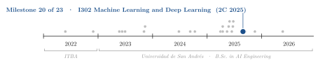
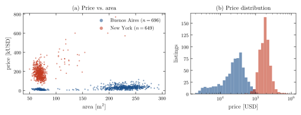
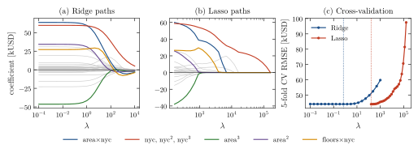
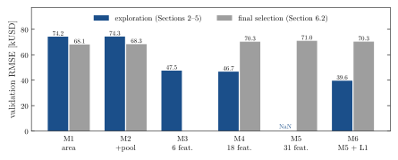
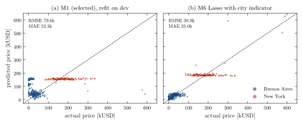

<div align="center">

# Linear Regression for Property Prices in Two Markets

**Santiago Groba Alonso**

Universidad de San Andrés · *Machine Learning and Deep Learning (I302)* · Second semester 2025 · Assignment 1

[](#reproducing-the-results)
[](#reproducing-the-results)

<picture>
  <source media="(prefers-color-scheme: dark)" srcset="docs/figures/trajectory-dark.svg">
  
</picture>

</div>

> **Abstract.** We predict listing prices for 1,345 properties with linear models implemented from scratch: a closed-form least-squares solver (pseudoinverse, with an optional ridge term) and gradient descent with a proximal step for the L1 penalty. The data mix two markets, Buenos Aires (median price 26.7 kUSD) and New York (180.9 kUSD), and this dominates every result. With area as the only feature the fitted slope is negative and the validation RMSE is 74.2 kUSD, because the larger properties are in the cheaper city. Adding a New York indicator to a six-feature model lowers it to 47.5 kUSD, and a 31-feature polynomial design with a Lasso penalty chosen by 5-fold cross-validation ($\lambda^\star = 163$) reaches 39.6 kUSD. The final selection step rebuilt the polynomial designs without the city indicator, so the univariate model was chosen; it scores 79.6 kUSD RMSE on the test set, against 38.9 kUSD for the Lasso model in a post-hoc check.

---

## 1. Problem

Given a development set of 1,600 property listings and a test set of 400, build a reproducible pipeline that predicts the price in USD from the listing attributes: type (house, apartment, PH), total and covered area (reported in m² or in square feet), number of rooms, floors, pool, latitude/longitude and age. The notebook follows the six parts of the assignment:

1. exploratory analysis of the raw data and preprocessing;
2. univariate and multivariate base models and residual analysis;
3. incremental models M1–M3 and the effect of a pool;
4. feature engineering (M4, M5);
5. Ridge and Lasso regularization of the largest design, with $\lambda$ chosen by cross-validation (M6);
6. model selection on validation and a single evaluation on the test set.

## 2. Methods

| Component | Choice |
|---|---|
| Estimator | `RegresionLineal` in `src/models.py`: least squares by pseudoinverse, ridge in closed form $(X^\top X + \lambda I')^{-1} X^\top y$ with an unpenalized intercept; gradient descent with an L2 term and soft-thresholding (proximal step) for L1 |
| Cleaning | Square feet converted to m²; listings with missing price or price below 2,000 USD dropped (1,600 → 1,345); age imputed with the median per property type; floors set to 1 for non-houses; one-hot encoding of the type; z-scores with training statistics |
| City indicator | `nyc` from latitude/longitude boxes (`src/utils.py`); all New York listings are reported in square feet and none has a pool |
| Models | M1: area. M2: area, pool. M3: area, pool, age, rooms, floors, `nyc`. M4: M3 plus squares and pairwise products (18 features). M5: M3 plus squares, cubes and pairwise products (31 features). M6: M5 with a Ridge or Lasso penalty |
| Validation | 80/20 train/validation split of the development set (seed 42); $\lambda$ by 5-fold CV on the training split, standardizing inside each fold, Lasso grid from $\lambda_{\max}$ down to $10^{-3}\lambda_{\max}$ with warm starts |
| Metrics | RMSE and MAE in USD |

## 3. Results

All numbers below are reproduced by `docs/figures/make_figures.py` from the code in `src/`, except the two M4 values, which come from the saved outputs of the notebook (see the notes under Table 1).

### 3.1 Two markets in one table

<p align="center"></p>

**Figure 1.** Development set after cleaning (1,345 listings). (a) New York listings are mostly apartments (617 of 649, median 69 m² once converted from square feet) and expensive; Buenos Aires listings are mostly houses (553 of 696, median 230 m²) and cheap. (b) The two price distributions barely overlap: the medians are 26.7 and 180.9 kUSD.

Fitting price on standardized area alone therefore gives a coefficient of −57.6 kUSD per standard deviation: within the pooled data, a larger property signals Buenos Aires. Once the indicator `nyc` enters (M3), the area coefficient turns positive (+17.9 kUSD per standard deviation) and `nyc` takes +195.1 kUSD. The pool coefficient behaves the same way: −15.3 kUSD in M2, +1.3 kUSD in M3, because all 237 pools in the development set are in Buenos Aires.

### 3.2 Regularization of the polynomial design

<p align="center"></p>

**Figure 2.** M5 design (31 features, with the city indicator) on the training split. (a) Ridge and (b) Lasso coefficient paths; the largest terms are colored, the rest are gray. Because `nyc` is binary, `nyc²` and `nyc³` are copies of it and share one path. (c) 5-fold cross-validation RMSE; dotted lines mark $\lambda^\star$.

Ridge selects $\lambda^\star = 0.695$ and Lasso $\lambda^\star = 162.9$, with practically the same CV error (MSE $1.946\times10^9$ and $1.941\times10^9$, about 44.1 kUSD RMSE). On the validation split the two give 39.7 and 39.6 kUSD; Lasso keeps 27 of the 31 coefficients. The same design without a penalty gives 39.7 kUSD, so shrinkage changes the validation error by less than 0.4 %: the CV curves are flat for small $\lambda$ and only rise, and the gain over M1 comes from the features.

### 3.3 Model comparison and final selection

<p align="center"></p>

**Figure 3.** Validation RMSE of every model in the two stages of the notebook. In the exploration stage M3–M6 include the city indicator; in the final selection the M4–M6 designs were rebuilt from the default feature list of the model classes, which uses the house dummy instead of `nyc`.

**Table 1.** Validation RMSE (kUSD).

| Model | Features | Exploration | Final selection |
|---|---|---:|---:|
| M1 | area | 74.2 | **68.1** |
| M2 | area, pool | 74.3 | 68.3 |
| M3 | area, pool, age, rooms, floors, `nyc` | 47.5 | – |
| M4 | M3 + squares and products (18) | 46.7 | 70.3 |
| M5 | M3 + squares, cubes and products (31) | NaN | 71.0 |
| M6 Ridge | M5, $\lambda^\star = 0.695$ | 39.7 | – |
| M6 Lasso | M5, $\lambda^\star = 162.9$ | **39.6** | 70.3 |

Notes: M1–M5 in the exploration column use the 80/20 split made inside the model classes, M6 and the final-selection column use the saved `casas_train.csv` / `casas_val.csv` split, so M1 differs between columns only by the split. The M5 NaN is the value printed by the notebook (the validation targets are misaligned in `M5.fit`). M4 values are the notebook outputs; the current `M4.fit` stops after the split and cannot be re-run.

The final selection picked M1, which was then refit on the full development set and evaluated once on the test set.

**Table 2.** Test-set errors (372 listings).

| Model | MAE (kUSD) | RMSE (kUSD) |
|---|---:|---:|
| M1, area only (selected, refit on development set) | 52.3 | 79.6 |
| M6 Lasso with city indicator (post-hoc check, trained on the training split) | 25.0 | 38.9 |

The test set was cleaned without the 2,000 USD threshold applied to the development set, so 34 of its 372 listings have prices below that value.

<p align="center"></p>

**Figure 4.** Predicted against actual price on the test set. (a) M1 can only order listings by area, so New York listings get an almost constant prediction and small Buenos Aires apartments are priced like New York ones. (b) With the city indicator, the Lasso model separates the two clusters; the remaining error is mostly the spread of prices inside New York.

## 4. Takeaways

- A pooled dataset of two markets breaks the single-linear-relation assumption. One indicator variable did more than any polynomial expansion of the area, and it also fixed the signs of the area and pool coefficients.
- With about 35 training observations per feature, Ridge and Lasso changed the validation error by less than 0.4 %. The regularization paths were still useful to see which terms (`area × nyc`, `floors × nyc`, the area polynomial) carry the signal.
- The feature pipeline has to be identical in tuning, selection and testing. Here a different default feature list in the last stage changed the decision, and the test error of the chosen model is twice that of the best tuned one.

## Reproducing the results

```bash
pip install -r requirements.txt
jupyter notebook notebooks/Entrega_TP1.ipynb   # submitted analysis (run from notebooks/)
python docs/figures/make_figures.py            # about 2 minutes; regenerates Figures 1–4 and prints Tables 1–2
```

The notebook cells were executed out of order when it was submitted (some depend on variables from earlier sessions), so its saved outputs are the reference; the figure script re-runs the same experiments with the code in `src/`.

| File | Content |
|---|---|
| `notebooks/Entrega_TP1.ipynb` | Submitted notebook: exploration, models M1–M6, regularization, test evaluation |
| `src/models.py` | `RegresionLineal` (pseudoinverse and gradient descent, L1/L2) and the M1–M5 model classes |
| `src/preprocessing.py` | Missing values, one-hot encoding, z-score normalization |
| `src/data_splitting.py` | Train/validation split and k-fold cross-validation |
| `src/metrics.py` | MSE, MAE, RMSE |
| `src/utils.py` | City indicator from coordinates, cross-validation and learning-curve helpers |
| `data/raw/` | Raw development (1,600 listings) and test (400) sets |
| `data/processed/` | Cleaned and standardized development, train, validation and test sets |
| `docs/figures/` | Script and style used for the figures in this README |

## Citation

```bibtex
@misc{groba2025housing,
  author       = {Groba Alonso, Santiago},
  title        = {Linear Regression for Property Prices in Two Markets},
  year         = {2025},
  howpublished = {Universidad de San Andr{\'e}s, Machine Learning and Deep Learning (I302)},
  url          = {https://github.com/Santi2065/TP1}
}
```
